# Roadmap and sequencing

Five phases, each closed by a gate. Phases 1–4 and their gates come from the spec's roadmap
diagram; **Phase 0 (Precursors) is added by this plan** because the repo is not yet ready for a
multi-month, multi-agent enterprise build (see "Why Phase 0" below). Durations are the spec's
proposals plus an estimate for Phase 0; they are re-forecast at every gate from measured throughput.

```mermaid
flowchart LR
  P0["Phase 0 · Precursors<br/>~3 weeks · 16 WPs"] --> G0{{"G0 · Engineering ready"}}
  G0 --> P1["Phase 1 · Foundations<br/>~6 weeks · 31 WPs"] --> G1{{"G1 · Every run produces a full trace"}}
  G1 --> P2["Phase 2 · Playground<br/>~6 weeks · 23 WPs"] --> G2{{"G2 · Templates pass their eval suites"}}
  G2 --> P3["Phase 3 · Teams and modes<br/>~8 weeks · 31 WPs"] --> G3{{"G3 · Security review signed off"}}
  G3 --> P4["Phase 4 · Enterprise scale<br/>~8 weeks · 19 WPs"] --> G4{{"G4 · GA"}}
  G4 --> V2["v2 · Open interop"]
```



Live progress per phase is in [`STATUS.md`](STATUS.md).

## Why Phase 0 — precursors found in the repo (2026-10-16)

| Finding | Evidence | Why it blocks an enterprise multi-agent build | Fixed by |
|---|---|---|---|
| No CI on pull requests | Only `desktop-release.yml` (tag-triggered Windows build) and a manual ontology transform workflow exist | Agents can merge regressions; nothing enforces the regression suite | WP-0003 |
| `npm ci` fails | `package-lock.json` lacks 8 direct deps (e.g. `@testing-library/react`, `jsdom`, `clsx`) | Clean installs and the release workflow are broken | WP-0002 |
| Failing test on `main` | `auto_service_reference_package::repair_completed_workflow_closes_the_originating_appointment` | CI cannot be a required check while `main` is red | WP-0016 |
| Migration order hazard | `migrate.rs` applies only versions above `MAX(version)` | Two agents' migrations merged out of order silently skip one forever | ADR-0003, WP-0003, WP-0007 |
| No offline model test double | Agent tests need a provider; the spec's behaviours (limits, retries, guardrails, modes) need deterministic scripts | Every Phase 1–4 behaviour test depends on it | WP-0005 |
| Thin frontend tests | 5 test files / 40 tests across 134 `.tsx` files; no E2E | The Playground is mostly UI | WP-0006, WP-0014 |
| Cross-cutting designs undefined | Run statuses, trace event schema, error classes, prompt catalog | 30+ Phase 1 WPs would each invent their own | WP-0009 |
| Spec claims not verified | e.g. spec says THIRD_PARTY_NOTICES exists — it does not | Designing on wrong assumptions | WP-0008, WP-0012 |
| No feature flags | — | Half-built features would ship in releases and the demo | WP-0010 |
| No threat model | — | Agents with write tools need threats named before building | WP-0011 |

## Critical path

The longest dependency chain decides the earliest finish. Keep these WPs staffed first; everything
else fills parallel lanes.

```
WP-0008 gap audit → WP-0009 ADRs → WP-0110 run/step schema → WP-0111 spans → WP-0112 SSE events
  → WP-0113 full-trace conformance (G1) → WP-0202 run API → WP-0203 Playground shell
  → WP-0204 trace pane → … → WP-0213 publish gate → WP-0221 templates (G2)
  → WP-0301 teams → WP-0302 playbooks → WP-0303 compiler → WP-0304 run controller
  → WP-0305 graph runtime → WP-0307 Manager-led → WP-0331 security review (G3)
  → Phase 4 (mostly parallel) → WP-0419 GA readiness (G4)
```

## Parallel lanes

Agents can work these lanes at the same time with little conflict. Lane boundaries follow code
boundaries to keep merge conflicts low.

| Phase | Lane | Work packages | Main code area |
|---|---|---|---|
| 0 | Repo hygiene and CI | 0016, 0002, 0004 → 0003 → 0006, 0007, 0011, 0014 | `.github/`, lockfiles, tests |
| 0 | Test double | 0005 → 0015 | `core/src/services/ai_*`, tests |
| 0 | Analysis and design | 0008 → 0009 → 0010; 0013 (owner) | `program/`, `decisions/` |
| 0 | Clean room | 0012 | root, `program/tools/` |
| 1 | Identity | 0101 → 0102, 0103 → 0104 | `server/src/session.rs`, auth |
| 1 | Run model and trace | 0110 → 0111 → 0112 → 0113 | `graph_runtime`, `events_stream`, run repos |
| 1 | Agent loop | 0121 → 0123, 0125, 0126; 0122, 0124, 0127, 0128 | `chat_service.rs`, `ai_service.rs` |
| 1 | Contracts and guardrails | 0130 → 0120; 0131, 0133 → 0132 | new `ai_tasks`, `ai_guardrails`, prompt catalog |
| 1 | Approvals | 0150 → 0151, 0152 → 0153; 0142 | `ai_approval*`, `ai_orchestration_service` |
| 1 | Tools | 0140, 0141, 0143, 0144 | `tool_registry`, `policy_engine` |
| 1 | Setup UX | 0160 | `desktop/src/features/settings/` |

`chat_service.rs` is a hotspot: several agent-loop WPs touch it. Sequence them (0121 first) or
split the loop into modules in WP-0121 before the others start.

## Sequencing rationale

1. **Precursors before features.** CI, a green `main`, reproducible installs, a model test double
   and fixed core designs are what make "no shortcuts" enforceable when several AIs contribute.
2. **Trace before Playground.** The Playground is a view over run traces (spec gate G1); building UI
   before the event schema exists would mean building it twice.
3. **Playground before new modes.** The spec ships the Playground (Phase 2) on today's pipelines so
   teams can be tested before the mode engine changes underneath them.
4. **Approvals unified early.** Every later feature (plan approval, review responses, MCP gate,
   standing approvals) builds on one approvals path, so the three legacy paths go first (WP-0150).
5. **SSO first in Phase 1** (spec decision) because Agent Identities (Phase 3) and approver routing
   map onto the customer's directory.
6. **Security review gates Phase 4** because Phase 3 adds autonomous multi-agent behaviour; scale
   features should not ship on top of unreviewed autonomy.

## Rolling-wave planning

Phase 0 and Phase 1 work packages are written in full. Phase 2–4 work packages are scoped from the
spec and stay `proposed`; at each gate review they are refined (precise acceptance criteria, XL
split into L or smaller) and moved to `ready`. Every spec requirement is already mapped to a work
package, so nothing can be forgotten — `programctl validate` fails if a requirement loses coverage.

## Re-forecasting

At each gate, record in the gate file: WPs completed, estimate points delivered (S=1, M=2, L=4,
XL=8), calendar days, and the forecast for the remaining phases. The spec's 28 weeks is a proposal;
Phase 3 holds 31 work packages including six XL, so expect the forecast to move at G1.
